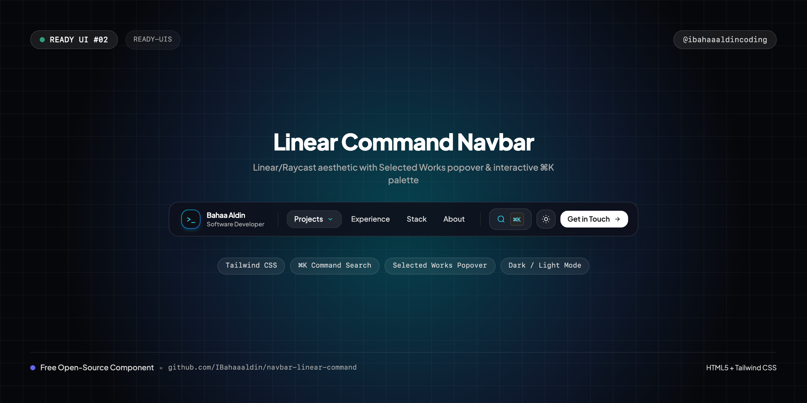
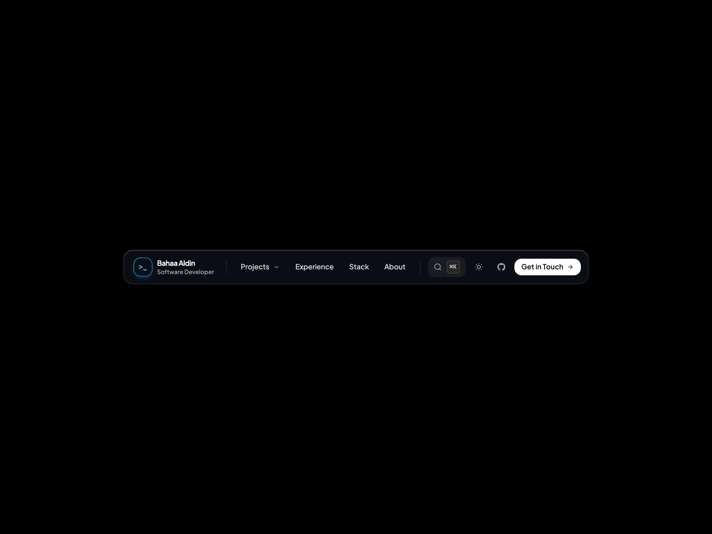
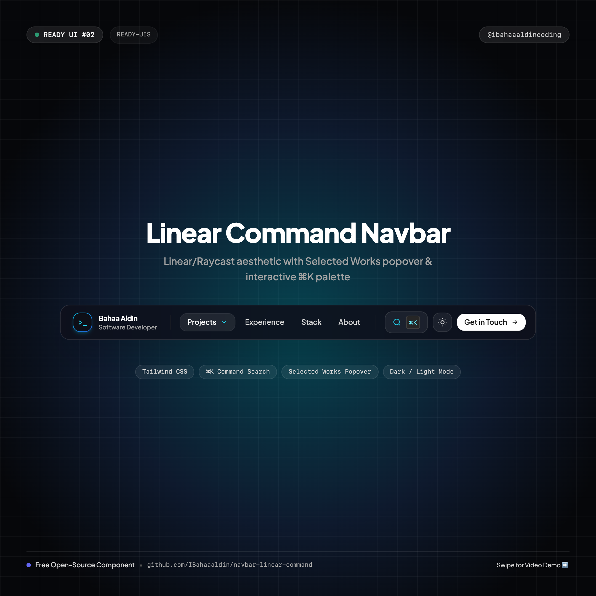

# ⚡ Linear Command Palette Navbar

> A centered, Linear/Raycast-inspired command bar on a minimal canvas with real-time project search, hoverable popover dropdown, and `⌘K` command palette.



[](https://IBahaaaldin.github.io/navbar-linear-command/)
[](https://IBahaaaldin.github.io/navbar-linear-command/)

---

## 🌐 Visual Previews

| Desktop Showcase (1200x900) | Mobile Showcase (390x844) | Instagram Cover (1080x1080) |
| :---: | :---: | :---: |
|  |  |  |

*(Includes full interaction videos: `video-desktop.mp4` and `video-mobile.mp4`)*

---

## ✨ Features & Micro-Interactions

- **Dead-Center Layout**: Floats cleanly in the exact middle of the page on an immaculate pure black (`#000000`) or white (`#ffffff`) canvas.
- **Fixed Dropdown Navigation**: Features an invisible hover bridge and click-toggle so you can smoothly glide down into the popover and click project links (*Air Canvas*, *Neon Aura AR*, *GPA & Finance Apps*).
- **Interactive `⌘K` Command Search Pop-up**:
  - Opens on clicking the `⌘K` button or pressing `⌘K` / `Ctrl+K` on the keyboard.
  - Full backdrop blur overlay with live filter input.
  - Quick actions to toggle theme, copy email, open GitHub, or navigate to projects.
  - Press `ESC` or click outside to dismiss.
- **Strict Single-Line Text**: All project names, tags, and titles are styled with `whitespace-nowrap` to prevent awkward line wrapping.
- **Responsive Mobile Drawer**: Mobile navigation with integrated search trigger and slide-down drawer.
- **One-Click Theme Switcher**: ☀️/🌙 button seamlessly flipping the entire page between dark and light themes.
- **Zero Build Step**: 100% self-contained HTML5 + Tailwind CSS CDN + inline SVGs.

---

## 📁 Repository Structure

```text
├── index.html              # Standalone production navbar component
├── cover.png               # Widescreen cover banner (1280x640)
├── cover-instagram.png     # Square cover for Instagram (@ibahaaaldincoding) (1080x1080)
├── screenshot-desktop.png  # Desktop visual preview (1200x900)
├── video-desktop.mp4       # Desktop interaction recording (MP4)
├── screenshot-mobile.png   # Mobile visual preview (390x844)
├── video-mobile.mp4        # Mobile interaction recording (MP4)
├── record.js               # Playwright automation script used to record all 4 assets
├── README.md               # Documentation & setup notes
└── CAPTION.md              # Ready-to-copy Instagram caption for @ibahaaaldincoding
```

---

## 🚀 Quick Start

### 1. View Locally
Simply open `index.html` in your browser:
```bash
open index.html
```

### 2. Keyboard Shortcut
Press `⌘ + K` (Mac) or `Ctrl + K` (Windows) to instantly trigger the Command Search pop-up.

---

## 📬 Connect

- **Instagram**: [@ibahaaaldincoding](https://www.instagram.com/ibahaaaldincoding)
- **GitHub**: [@IBahaaaldin](https://github.com/IBahaaaldin)
- **LinkedIn**: [Bahaa Mohammed](https://www.linkedin.com/in/bahaa-mohammed-371259369)
- **Email**: bahaam.coding@gmail.com
